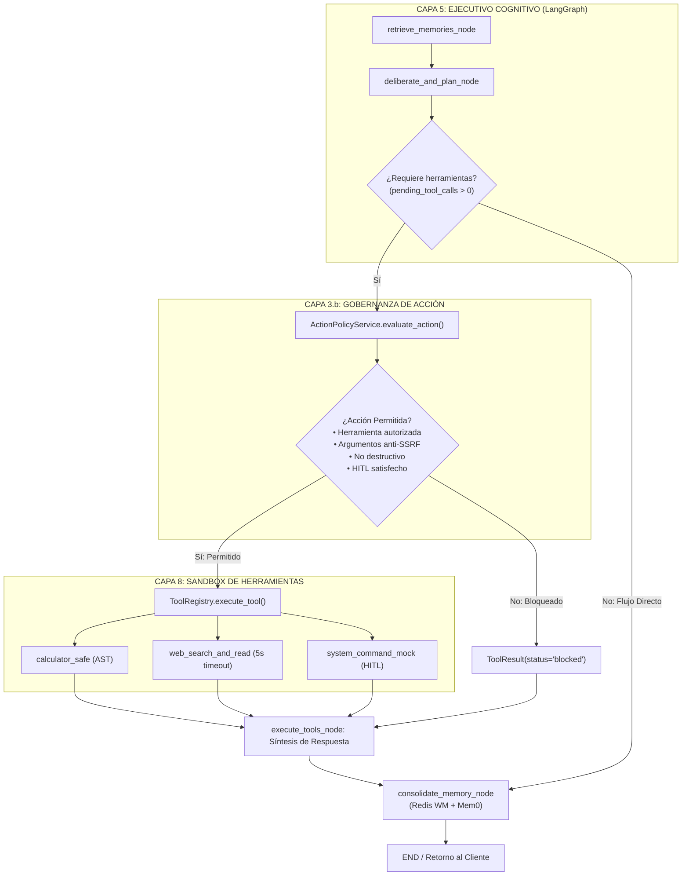

# PLAN DE TRABAJO OPERATIVO — FASE 4
## Proyecto de Tesis: Asistente Cognitivo Modular (JARVIS 0.0)
**Código Documental:** `TR-COG-2026-PLAN-F4`  
**Título:** Activación del Ciclo ReAct, Gobernanza de Acción y Sandbox Confinado de Herramientas  
**Metodología:** *Core-to-Periphery* + Monolito Modular Hexagonal + Test-Driven Development (TDD)  
**Taxonomía Vigente:** 10 Capas Funcionales + 2 Planos Transversales (`DATA/arquitectura_10_capas.md`, ADR 007)  
**Rama Git:** `semana1-tronco-encefalico`  
**Línea Base Verificada:** Commit `ebfcec1` (Fase 1, Fase 2 y Fase 3 cerradas con 46 tests verdes)  
**Fecha de Emisión:** 11 de Octubre, 2026  
**Autor:** Moisés  

---

## 1. Resumen Ejecutivo y Estado de Partida

### Estado Actual del Núcleo Cognitivo
Al inicio de esta fase, el Asistente Cognitivo cuenta con:
1. **Infraestructura y Persistencia (Fase 1):** Conexión no colisionante con PostgreSQL 16 + `pgvector` en puerto 5433, modelo declarativo `AuditTransaction` y `AuditService` asíncrono con `asyncpg`.
2. **Memoria Activa (Fase 2):** Redis 7 con `WorkingMemoryManager`, ventana deslizante de 6 turnos, TTL de 24h y namespace de aislamiento `user:{user_id}:session:{session_id}:wm`.
3. **Gobernanza Perimétrica de Entrada (Fase 3):** `PromptGuard` determinista (<1ms) contra Jailbreaks e inyecciones, sanitizador NFKC, filtro de datos sensibles antes de Mem0, autenticación `X-API-Key`, Rate Limiting Token Bucket sobre Redis y validador anti-SSRF.
4. **Verificación Formal:** 46 pruebas automatizadas aprobadas (`pytest -q`).

### Justificación de la Fase 4
Hasta la Fase 3, el Asistente opera de manera puramente conversacional en memoria. La **Fase 4** activa la **agencia periférica (Capa 7 Agentes y Capa 8 Sandbox)**, permitiendo que el grafo deliberativo de LangGraph decida autónomamente invocar herramientas externas (cálculo determinista, navegación y lectura web) bajo la supervisión de un segundo punto de control de gobernanza: la **Gobernanza de Acción (Capa 3.b)**.

---

## 2. Mapa Arquitectónico del Ciclo ReAct (Fase 4)



---

## 3. Desglose Operativo por Etapas de Trabajo

```mermaid
gantt
    title Plan de Ejecución Fase 4
    dateFormat  X
    axisFormat  Bloque %s
    section Desarrollo
    Etapa 4.1 - Catálogo y Contratos Sandbox (ToolRegistry) :active, e41, 0, 2
    Etapa 4.2 - Gobernanza de Acción (ActionPolicyService)   :e42, after e41, 2
    Etapa 4.3 - Grafo ReAct LangGraph (execute_tools_node)  :e43, after e42, 2
    Etapa 4.4 - Hardening Timeouts Web (Playwright 5s)      :e44, after e43, 1
    section Pruebas & Cierre
    Etapa 4.5 - Suite Integral y Cierre Verificado          :e45, after e44, 2
```



---

### ETAPA 4.1: Catálogo y Sandbox Tipado de Herramientas (`ToolRegistry`)
* **Objetivo:** Definir contratos estrictos en Pydantic v2 para herramientas periféricas, evitando tipados débiles y permitiendo introspección segura en tiempo de ejecución.
* **Componentes a Modificar / Crear:**
  - `src/cognitive_assistant/shared/tools/registry.py`:
    - Modelos: `ToolRiskLevel` (`LOW`, `MED`, `HIGH`, `CRITICAL`), `ToolParameter`, `ToolDefinition`, `ToolRequest`, `ToolResult`.
    - Clase `ToolRegistry` (patrón Singleton/Service):
      - `register_tool(definition: ToolDefinition, handler: Callable) -> None`
      - `get_tool(name: str) -> Optional[ToolDefinition]`
      - `list_tools() -> List[ToolDefinition]`
      - `execute_tool(request: ToolRequest) -> ToolResult`
    - Herramientas nativas:
      - `calculator_safe`: Intérprete aritmético basado en `ast.parse` (recorrido seguro de árbol sin `eval()`).
      - `web_search_and_read`: Wrapper con validación de URL y extracción a Markdown limpio.
      - `system_command_mock`: Herramienta simulada de alto riesgo con bandera `requires_approval=True`.
  - `src/cognitive_assistant/shared/tools/__init__.py`: Exportar símbolos públicos.
* **Criterios de Aceptación:**
  - `calculator_safe` resuelve expresiones complejas (`(15 * 4) + sqrt(144) - 2^3`) con precisión decimal.
  - Expresiones con funciones no registradas o sintaxis maliciosa (`__import__`, `open`) son rechazadas antes de evaluación.
  - Tiempo de ejecución de `calculator_safe` < 1 ms.

---

### ETAPA 4.2: Gobernanza de Acción y Control de Políticas (Capa 3.b)
* **Objetivo:** Garantizar que ninguna herramienta se dispare sin una auditoría preventiva de riesgo, mitigando que un modelo alucinado o inyectado use herramientas para atacar la infraestructura interna o exfiltrar datos.
* **Componentes a Modificar / Crear:**
  - `src/cognitive_assistant/modules/c3_governance/policy.py`:
    - Modelo `ActionPolicyDecision` (`allowed`, `risk_level`, `requires_hitl`, `violation_type`, `reason`, `trace_id`, `metadata`).
    - Servicio `ActionPolicyService.evaluate_action(request: ToolRequest, tool_def: Optional[ToolDefinition]) -> ActionPolicyDecision`:
      1. **Validador de Catálogo:** Rechaza invocación si `tool_def is None` (`violation_type="unauthorized_tool"`).
      2. **Validador Anti-SSRF:** Inspecciona argumentos de tipo URL mediante `validate_outbound_url()` (bloquea 127.0.0.1, rangos privados 10.x, 192.168.x y metadatos cloud 169.254.169.254).
      3. **Validador de Inyección de Comandos:** Expresiones regulares defensivas contra patrones destructivos (`rm -rf`, `; del`, `| bash`, `format`).
      4. **Validador Human-in-the-Loop (HITL):** Bloquea operaciones clasificadas como `CRITICAL` si `hitl_approved == False`.
  - `src/cognitive_assistant/modules/c3_governance/__init__.py`: Exportar `ActionPolicyDecision` y `ActionPolicyService`.
* **Criterios de Aceptación:**
  - Toda llamada a URL privada es bloqueada devolviendo `allowed=False` y `violation_type="ssrf_attempt"`.
  - Operaciones `CRITICAL` no aprobadas se rechazan con `violation_type="hitl_required"`.

---

### ETAPA 4.3: Orquestación del Grafo ReAct en LangGraph (Capa 5)
* **Objetivo:** Transformar el grafo lineal de 3 nodos en un StateGraph dinámico con bifurcación condicional ReAct.
* **Componentes a Modificar / Crear:**
  - `src/cognitive_assistant/modules/c4_executive/state.py`:
    - Extender `CognitiveState` con `pending_tool_calls: Optional[List[Dict[str, Any]]]` y `tool_results: Optional[List[Dict[str, Any]]]`.
  - `src/cognitive_assistant/modules/c4_executive/graph.py`:
    - Actualizar `deliberate_and_plan_node`: Detectar si el usuario requiere cálculo o búsqueda web y poblar `pending_tool_calls`.
    - Función de enrutamiento condicional:
      ```python
      def should_use_tool(state: CognitiveState) -> str:
          calls = state.get("pending_tool_calls") or []
          return "execute_tools" if len(calls) > 0 else "consolidate_memory"
      ```
    - Crear `execute_tools_node(state: CognitiveState) -> Dict[str, Any]`:
      - Evalúa cada llamada con `ActionPolicyService`.
      - Despacha las permitidas a `ToolRegistry.execute_tool()`.
      - Sintetiza la respuesta perceptual estructurada y actualiza los pasos del plan cognitivo.
    - Recompilar grafo:
      - `builder.add_conditional_edges("deliberate_and_plan", should_use_tool, ...)`
      - `builder.add_edge("execute_tools", "consolidate_memory")`
* **Criterios de Aceptación:**
  - Consultas estándar sin herramientas (ej. *"Hola, ¿cómo estás?"*) pasan directo a consolidación sin latencia añadida.
  - Consultas matemáticas o de búsqueda web transitan por `execute_tools` y presentan la síntesis en la respuesta.

---

### ETAPA 4.4: Hardening de Timeouts y Resiliencia en Navegación Web
* **Objetivo:** Blindar la herramienta periférica de navegación para evitar cuelgues del bucle de eventos ante páginas no disponibles.
* **Componentes a Modificar:**
  - `src/cognitive_assistant/shared/tools/web_browser.py`:
    - Ajustar timeout por defecto de Playwright a 5,000 ms (`default_timeout_ms = 5000`).
    - Envolver llamadas de red con captura de timeout y conversión a resultado controlado (`ToolResult(status="error", error="Timeout de navegación excedido (5000ms)")`).
* **Criterios de Aceptación:**
  - Peticiones web a URLs caídas responden con fallo limpio en < 5.5 segundos sin colgar la API.

---

### ETAPA 4.5: Protocolo Integral de Pruebas Automatizadas y Cierre
* **Objetivo:** Escribir y ejecutar las suites de pruebas unitarias e integrales que garanticen que la Fase 4 cumple con la regla vinculante del proyecto (*"hito superado = test en verde"*).
* **Suites a Implementar:**
  1. `tests/test_tool_registry.py`:
     - Test de introspección y catálogo de herramientas.
     - Test de ejecución correcta de `calculator_safe` (operaciones básicas, compuestas y funciones matemáticas).
     - Test de control de errores (división por cero, sintaxis maliciosa).
     - Test de ejecución controlada de `system_command_mock`.
  2. `tests/test_governance_action.py`:
     - Test de bloqueo anti-SSRF en argumentos de herramientas.
     - Test de rechazo de inyección de comandos en parámetros.
     - Test de exigencia de HITL en herramientas `CRITICAL`.
     - Test de trazabilidad (`trace_id` propagado en la evaluación de política).
  3. `tests/test_react_cycle.py`:
     - Test de ejecución completa del grafo LangGraph con bifurcación ReAct.
     - Test de persistencia de resultados de herramientas en Working Memory de Redis.
* **Criterios de Aceptación:**
  - Ejecución de `pytest -q` con resultado **>= 50 tests en verde, 0 fallos, 0 skipped**.

---

## 4. Matriz de Entregables y Archivos Afectados

| Componente | Archivo | Acción | Responsabilidad en Fase 4 |
| :--- | :--- | :--- | :--- |
| **Capa 8 Sandbox** | `shared/tools/registry.py` | Crear / Consolidar | Catálogo tipado, `ToolRegistry`, contratos y `calculator_safe`. |
| **Capa 8 Tools** | `shared/tools/web_browser.py` | Modificar | Timeout reducido a 5s y manejo de errores. |
| **Capa 8 Exports** | `shared/tools/__init__.py` | Modificar | Exponer símbolos y contratos de herramientas. |
| **Capa 3.b Gobernanza** | `modules/c3_governance/policy.py` | Crear / Consolidar | `ActionPolicyService` y control preventivo de riesgo. |
| **Capa 3 Exports** | `modules/c3_governance/__init__.py` | Modificar | Exponer `ActionPolicyService` y `ActionPolicyDecision`. |
| **Capa 5 Estado** | `modules/c4_executive/state.py` | Modificar | Campos `pending_tool_calls` y `tool_results`. |
| **Capa 5 Grafo** | `modules/c4_executive/graph.py` | Modificar | Nodo `execute_tools_node` y arista condicional `should_use_tool`. |
| **Pruebas Sandbox** | `tests/test_tool_registry.py` | Crear | Validación unitaria de herramientas y cálculo AST. |
| **Pruebas Gobernanza** | `tests/test_governance_action.py` | Crear | Validación de políticas anti-SSRF, comandos y HITL. |
| **Pruebas Integración** | `tests/test_react_cycle.py` | Crear | Validación de ciclo ReAct completo en LangGraph. |

---

## 5. Estimación Temporal y Bloques de Ejecución

El plan está estructurado para ejecutarse en **4 bloques de trabajo (aprox. 3 horas en total)**:

```text
Bloque 1 (45 min): Consolidación de ToolRegistry y contratos en shared/tools/
Bloque 2 (45 min): Implementación y verificación de ActionPolicyService (Capa 3.b)
Bloque 3 (45 min): Cableado del StateGraph con bifurcación ReAct en LangGraph (Capa 5)
Bloque 4 (45 min): Construcción de suites de pruebas y ejecución integral de pytest
```

---

## 6. Criterio de Aceptación Final (Definición de Terminado)

La **Fase 4** se considerará formalmente concluida y lista para commit únicamente cuando se cumplan las siguientes 5 condiciones:
1. `ToolRegistry` permite registrar, listar y despachar herramientas de manera segura.
2. `ActionPolicyService` intercepta y neutraliza intentos de SSRF o comandos arbitrarios en argumentos.
3. El grafo deliberativo de LangGraph bifurca hacia `execute_tools_node` solo cuando existen llamadas pendientes y sintetiza la salida de forma transparente.
4. Toda la suite de pruebas (`pytest -q`) finaliza con **>= 50 tests en verde** (0 errores, 0 regresiones).
5. Se genera un único commit formal en Git:
   ```bash
   git commit -m "feat(react): integracion de ToolRegistry, gobernanza de accion Capa 3.b y ciclo ReAct en LangGraph (Fase 4)"
   ```
